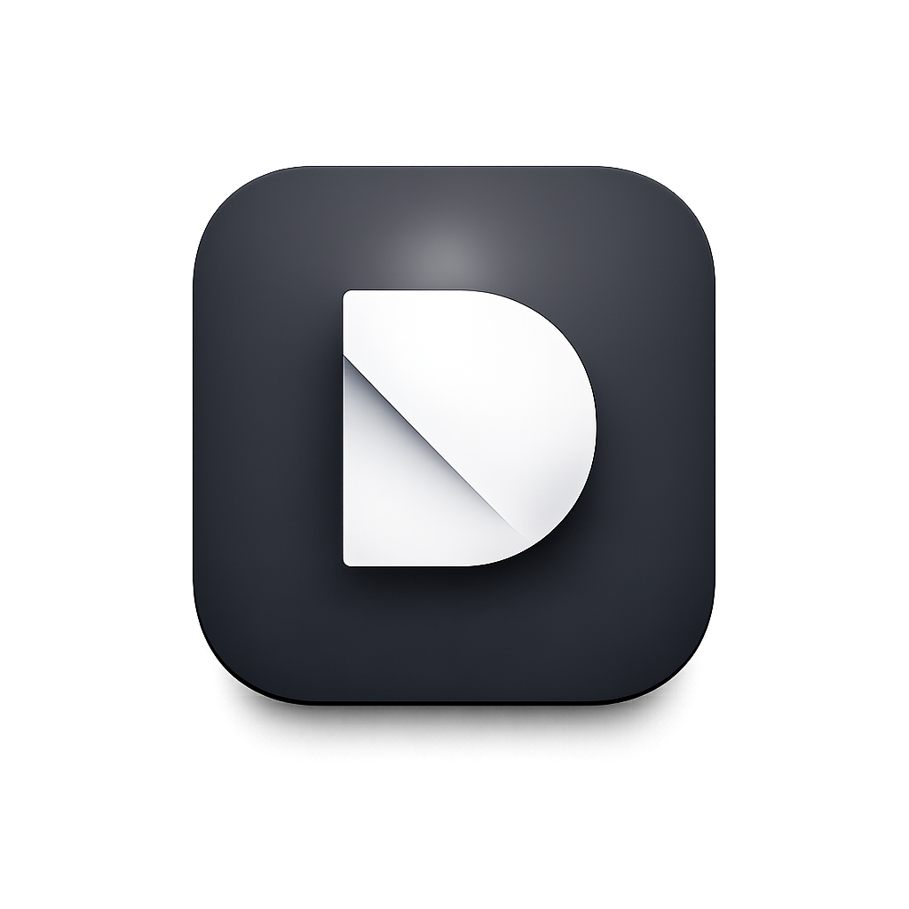

<p align="center">
  
</p>

<h1 align="center">den — landing page</h1>

<p align="center">Somewhere safe to let agents run wild.</p>

---

Marketing landing page for **den**, the app for [Docker Sandboxes](https://docs.docker.com/ai/sandboxes/).
den gives every coding agent a sandbox of its own — a private microVM with its own
filesystem, daemon, and guarded network — so it can build, install, and rewrite
freely while your machine never stirs. This is a single static page with a warm
"paper" aesthetic, a light/dark theme, and live embeds of the real den UI.

## Preview


## Highlights

- **Light / dark theme** — toggle in the nav; persists to `localStorage` and respects the OS preference. Applied before first paint to avoid a flash.
- **Interactive 3D map** — a topographic "den country" (Three.js) of live sandboxes you can drag/pan; click a dot for a detail card. Fog and cards recolor per theme.
- **Live product embeds** — the real den UI (`den-ui.html`) is embedded and cropped to show:
  - the **sandbox list** (with a cursor tapping "＋ new sandbox"),
  - the **network policy** panel (with a looping "add rule" animation),
  - a **kit's capabilities** (Remote MCPs, network, env vars, agent memory).
  These stay in sync with the site theme.
- **Shuffling hero art** — a random header from `resources/headers/` on every load (picked inline before the hero paints, so nothing else is downloaded), and click the hero pill to fade in another. Drop any image into that folder and it's picked up automatically when served over HTTP; the load-time pick uses the list baked into `index.html`, so add the filename there too if you want it in the initial rotation.
- **FAQ** — plain-English accordions (one open at a time) summarized from the docs, each linking to the relevant page.
- **Download buttons** — resolve to the latest macOS GitHub release asset (`.dmg`) via the GitHub API, falling back to the releases page. den is macOS only for now; the page says Windows and Linux are coming soon.
- **Responsive** — mobile hamburger nav and a shorter hero mockup on small screens.

## Getting started

Static site, no build step. It relies on `fetch`/iframes, so **serve it over HTTP**
(some features — the header folder-listing, the live embeds — don't work from a
raw `file://` open):

```bash
python3 -m http.server 8000
# then visit http://localhost:8000
```

## Structure

| Path | Description |
| --- | --- |
| `index.html` | The landing page (the current, canonical version) |
| `den-ui.html` | The interactive den app demo, embedded live in the page. Accepts `?theme=light\|dark`, `?color=`, and `?embed=network\|kit` |
| `microvm-lake.html` | Standalone version of the 3D map exploration |
| `resources/` | Logo, icons, brand-mono agent logos, and `headers/` (swappable hero art) |
| `screenshots/` | App and landing-page screenshots |
| `LICENSE.md` | FSL-1.1-Apache-2.0 (fair-source) |

## License

Released under the **Functional Source License (FSL-1.1-Apache-2.0)** — fair-source:
use, modify, and self-host it freely, just not to build a competing product. Each
release converts to Apache 2.0 two years after publication. See [`LICENSE.md`](LICENSE.md).
