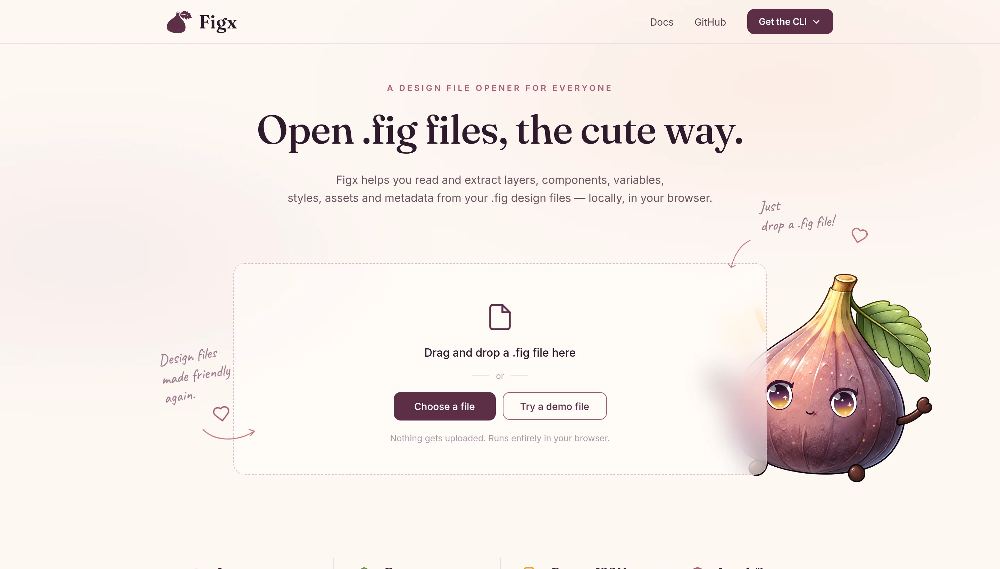
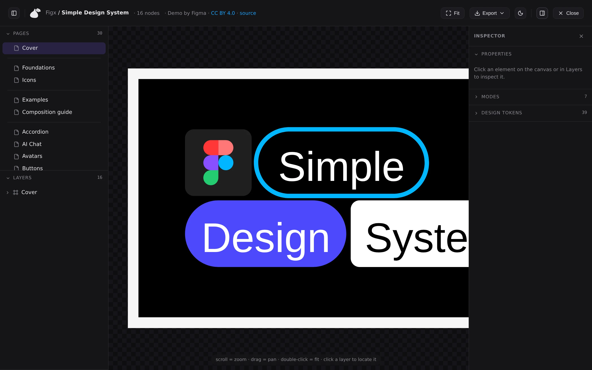

# figx

[](https://github.com/oyabun/figx/actions/workflows/ci.yml)
[](LICENSE)

A personal, offline **`.fig` file viewer** — decode and preview old Figma designs
without the Figma app. No account, no cloud, no plugin.

This is a proof-of-concept: it decodes Figma's proprietary binary format and
renders the scene graph to SVG.

**[Live demo](https://oyabun.github.io/figx/)** — drop a `.fig` file, or try
one of the bundled samples (needs GitHub Pages enabled on this repo first;
see the "docs/" section further down if it's 404ing).



## Quick start

```bash
npm install

# render a .fig to a standalone HTML file
node src/cli/cli.js render "path/to/design.fig" preview.html
open preview.html

# or run the full interactive viewer (drag & drop, pan/zoom, layers,
# design-token inspector) — it's docs/index.html, a fully static page with
# no backend, so any local HTTP server in front of it works (it can't be
# opened directly via file:// — browsers block ES module imports from that
# origin):
npx serve docs
# → http://localhost:3000
```

> Requires Node 18+. This project uses Node's built-in ESM, `fflate`
> (DEFLATE + zip), `fzstd` (Zstandard), and `kiwi-schema` (Kiwi decoder).

The interactive viewer — pan/zoom, a Pages/Layers sidebar, and a right-side
Inspector with per-node Properties, variable Modes, and Design Tokens:



## Testing

```bash
npm test
```

Runs on Node's built-in test runner (`node --test`, no extra dependency).
`decode.js`'s Kiwi-schema decoding itself isn't covered — that needs a real
`.fig` sample, which (being Figma's own undocumented, proprietary format)
isn't checked into the repo — but everything downstream of it is: `test/`
hand-builds the plain JS object shape `decodeFig()` would hand back (see
`test/fixtures.js`) and exercises `render.js`/`tokens.js`/`variables.js`/
`tree.js`/`path.js` against it, plus `decode.js`'s binary chunk-framing
directly (magic detection, chunk length parsing, truncation handling) with
synthetic byte buffers. CI also rebuilds `docs/libs/figx-engine.js` and
fails if it doesn't match what's committed, so an engine-affecting change
can't ship without also updating the bundle GitHub Pages actually serves.

## Commands

Run `node src/cli/cli.js --help` (or `-h`) for the full colorized reference with
worked examples for every command — respects `NO_COLOR`/`--no-color`/`FORCE_COLOR`
and skips the mascot logo on piped/redirected output.

| Command | What it does |
| --- | --- |
| `node src/cli/cli.js render <file.fig> [out.html]` | Standalone HTML preview (inline SVG) |
| `node src/cli/cli.js decode <file.fig> [out.json]` | Dump the decoded scene graph as JSON (blobs elided) |
| `node src/cli/cli.js export <file.fig> [outDir]` | Export matching nodes (frames by default) as standalone `.svg` files |
| `node src/cli/cli.js preview <file.fig>` | Render inline in the terminal (Kitty/iTerm2/ANSI) |
| `node src/cli/cli.js browse <file.fig>` | Interactive gallery picker with a full-screen preview |
| `node src/cli/explore.js <file.fig>` | Print node-type stats and sample node shapes |

### Exporting frames or objects

`export` renders each matching node (+ its descendants) as its own tightly-cropped
standalone SVG file — the same logic the web viewer's per-node "Export" button uses,
available from the command line for batch/scripted use:

```bash
# every top-level frame, one .svg per frame, into design-frames/
node src/cli/cli.js export design.fig

# every object of any type whose name contains "icon"
node src/cli/cli.js export design.fig icons/ --type=ALL --name=icon

# a specific node by guid (see --list), or a specific type
node src/cli/cli.js export design.fig --id=123:456
node src/cli/cli.js export design.fig --type=COMPONENT,COMPONENT_SET

# see what would be exported without writing files
node src/cli/cli.js export design.fig --list
```

### Previewing in the terminal

`preview` renders straight into the terminal — no browser, no external tools
(no `chafa`, no ImageMagick). SVG is rasterized in-process via a WASM build of
[resvg](https://github.com/RazrFalcon/resvg) (`@resvg/resvg-wasm`) and emitted
as whichever image format the terminal supports: Kitty's graphics protocol,
iTerm2's inline-image protocol, or (universal fallback, needs only truecolor
support) 24-bit ANSI "half block" art. Detected from `$TERM`/`$TERM_PROGRAM`;
override with `FIGX_PREVIEW_PROTOCOL=kitty|iterm2|ansi` if it guesses wrong.

```bash
node src/cli/cli.js preview design.fig                # page 0
node src/cli/cli.js preview design.fig --page=1
node src/cli/cli.js preview design.fig --name=icon     # same --type/--name/--id filters as export
```

### Browsing interactively

`browse` opens a thumbnail gallery: type to filter by name, arrow keys to move
between cells, Enter to pop the highlighted one into a full-screen preview
(arrows there flip to the next/previous item without leaving full-screen;
Esc goes back to the grid). Enter again in full-screen picks it — prints
`type<TAB>name<TAB>guid` and exits, so it composes with the rest of the CLI:

```bash
node src/cli/cli.js browse design.fig
node src/cli/cli.js browse design.fig --type=ALL --name=icon   # narrow the initial list

# pipe the pick into export
guid=$(node src/cli/cli.js browse design.fig | cut -f3)
node src/cli/cli.js export design.fig --id="$guid"
```

This needs a real terminal (stdin/stdout must be a TTY) and refuses to run
otherwise — it's a convenience for humans, never required. Everything it can
do is also reachable directly through flags, which is what scripts and
agents should use instead: `export --list` to see every match, `--name`/
`--type`/`--id` to select one, `preview` to render it.

The toolbar/labels/help-bar chrome respects [`NO_COLOR`](https://no-color.org/)
(set to anything, including empty) and a `--no-color` flag. This only affects
that chrome — the actual preview images stay full color regardless, same as
an image viewer wouldn't grayscale photos because `$NO_COLOR` is set.

## Compiling a standalone binary

`npm run build:cli` bundles the CLI (esbuild), embeds resvg's WASM module as a
SEA asset (for `preview`), and injects it all into a copy of the `node` binary
using Node's built-in single-executable-application support — `dist/figx` runs
on its own, no `node`/`node_modules` needed:

```bash
npm run build:cli
dist/figx export design.fig --list
```

The embedded binary must be an **official** Node.js build (nodejs.org, nvm,
Homebrew, the Windows/macOS installers) — some Linux distro packages (e.g.
Debian/Ubuntu's `nodejs` apt package) strip the injection sentinel and can't
be used as the base. If the build script reports injection failing for that
reason, point it at an official build instead:

```bash
FIGX_BUILD_NODE=/path/to/official/node npm run build:cli
```

## docs/ — the landing page, served on GitHub Pages

`docs/index.html` is a full standalone site: the marketing landing (mascot,
drag-and-drop, feature/showcase sections) plus the *entire* interactive
viewer (pan/zoom, layers sidebar, page switcher, right-click export, theme
toggle, per-node design-token inspector) embedded in the same page as a
full-screen overlay (`#figx-app`), shown once a `.fig` file decodes. It runs
entirely **client-side** — `decodeFig`/`renderPages`/`renderSvg`/
`extractVariables`/`extractStyles`/`tokensToCss` all execute directly in the
browser via a bundled copy of the engine, so the page needs no backend at
all and can be served as plain static files (a GitHub Pages branch,
Cloudflare Pages, `python3 -m http.server`, whatever).

That bundle (`docs/libs/figx-engine.js` — `libs/`, not `assets/`, since it's
compiled code rather than a media asset) is esbuild output from
`src/browser-engine.js` (which just re-exports `decodeFig`/`renderPages`/
`renderSvg`/`extractVariables`/`extractStyles`/`tokensToCss`), checked into
the repo since GitHub Pages has no build step of its own. **Rebuild and
commit it whenever `decode.js`/`render.js`/`tree.js`/`path.js`/`tokens.js`
change:**

```bash
npm run build:docs-engine
```

There used to be two other things standing in for what `docs/index.html`
already does on its own: a root `index.html` that POSTed to
`api/render.js`/`api/tokens.js` (Vercel serverless functions), and
`src/server.js` (`npm run serve`), a local dev server with its own separate
716-line embedded UI. Both were pure duplication — `docs/index.html` is a
complete, self-contained viewer that runs anywhere over plain HTTP — so both
were removed. For local testing before you push, front `docs/` with any
static server (see Quick start above).

**To actually serve it on GitHub Pages** (one-time repo setup, not something
than can be done from inside a sandbox without push access): push this repo
to GitHub, then in the repo's Settings → Pages, set Source to "Deploy from a
branch" and pick `main` / `/docs`. The site will be live at
`https://<user>.github.io/<repo>/` a minute or two later. Any subsequent push
to `main` that touches `docs/` redeploys automatically — there's no CI step
to wire up beyond that, since the engine bundle is already committed.

## How `.fig` decoding works

Figma files are undocumented but well reverse-engineered. The format is
**self-describing** — each file embeds its own schema.

```
.fig (optionally a ZIP wrapper: canvas.fig + images/ + meta.json)
└─ canvas.fig
   ├─ [8 bytes] ASCII magic  "fig-kiwi" | "fig-jam." | "fig-deck"
   ├─ [uint32 ] version (little-endian)
   └─ chunks, each: [uint32 length][compressed body]
        chunk 0  → binary Kiwi SCHEMA           (decodeBinarySchema)
        chunk 1  → document MESSAGE             (compiled schema.decodeMessage)
        chunk 2+ → image/PNG blobs
```

Chunk bodies are DEFLATE (raw or zlib) or Zstandard — the decoder sniffs the
magic bytes and picks the right one. See `src/decode.js`.

The decoded message contains `nodeChanges`: a **flat** list of nodes. Each node
carries a `guid`, a `parentIndex` (parent guid + fractional-index `position`
string for sibling order), an affine `transform` relative to its parent, a
`size`, `fillPaints`/`strokePaints`, and `fillGeometry`/`strokeGeometry`.
`src/tree.js` reassembles the hierarchy and computes world transforms;
`src/render.js` walks it and emits SVG.

### Baked path geometry (`src/path.js`)

The key to accurate shapes. `fillGeometry`/`strokeGeometry` reference a
`commandsBlob` index into `message.blobs`. Each blob is a **tagless-header
stream of path commands** — `[uint8 tag][float32 …]` in the node's local space:

| tag | command | floats |
| --- | --- | --- |
| `0x00` | close | — |
| `0x01` | move  | x, y |
| `0x02` | line  | x, y |
| `0x03` | quad  | cx, cy, x, y |
| `0x04` | cubic | c1x, c1y, c2x, c2y, x, y |

e.g. a 100×100 rect → `M0 0L100 0L100 100L0 100L0 0Z`; an 8×8 circle → a move +
four cubics with control offset `4·0.5523`. Figma bakes **strokes** into
`strokeGeometry` as filled outline regions, so those are *filled* with the
stroke paint (not stroked) — this is why connector lines render as smooth
curves.

## Rendering fidelity

Working today:

- Full hierarchy, sibling ordering, and per-node affine transforms
- **Real path geometry** — rects, rounded corners, ellipses, vector icons, and
  curved connectors, all decoded from command blobs into SVG `<path>`
- **Component instances** — instances store no children of their own; their
  content lives in a referenced master symbol. The renderer instantiates that
  subtree re-rooted at the instance's transform (`src/render.js`,
  `renderNode` → INSTANCE expansion), so instances aren't empty.
- **Masks** — a child with `mask:true` clips its following siblings. Handled via
  SVG `<clipPath>`, collecting the *painted* geometry of the mask subtree
  (frames/nested instances included; transparent bounding rects skipped). This
  is what makes Figma's "icon masks a colour swatch" pattern render as real
  glyphs instead of grey squares.
- Solid fills & strokes and **linear gradients** (fills and strokes)
- **Multiple pages** — one SVG per visible `CANVAS`, each with its own computed
  bounds; the web viewer shows a page switcher. Figma's internal/hidden pages
  (`visible:false` / `internalOnly`, e.g. design-token canvases) are excluded.
- **Effects** — drop shadow, inner shadow (approx.), and layer blur, via SVG
  `<filter>` (`buildFilter` in `src/render.js`).
- **Blend modes** — node- and paint-level `blendMode` mapped to CSS
  `mix-blend-mode` (multiply, screen, overlay, …).
- **Transparency** — node opacity and per-paint opacity (folded into alpha).
- Winding rule (`NONZERO`/`ODD` → `nonzero`/`evenodd`)
- Node visibility, text (content, font family/size, color)
- viewBox + background pulled from the exported `meta.json`

Known gaps / roadmap:

- **Per-character text style runs** (`textData.styleOverrideTable`): syntax-style
  coloring and highlighted text chips render as a single flat color for now.
- Instance text/paint overrides: master content shows, but per-instance text
  edits use a foreign guid namespace we don't yet remap, so overridden text may
  fall back to the master's.
- Radial/angular gradients, image fills (linking `images/` by hash)
- Background blur (needs a backdrop), noise/glass/grain effects
- Auto-layout reflow (positions are baked into transforms, so static viewing
  works without it)

## Caveats

The `.fig` format is an **unstable internal implementation detail** of Figma and
can change without notice. Because files embed their own schema, this decoder
should stay resilient to schema drift, but rendering assumptions may need
updates for files from very different Figma versions. Verified against
`fig-kiwi` version 106.

## Credits

figx decodes/renders on top of:

- [`fflate`](https://github.com/101arrowz/fflate) (MIT) — DEFLATE/zip
- [`fzstd`](https://github.com/101arrowz/fzstd) (MIT) — Zstandard
- [`kiwi-schema`](https://github.com/evanw/kiwi) (MIT) — Kiwi binary schema decoding
- [`@resvg/resvg-wasm`](https://github.com/yisibl/resvg-js) (MPL-2.0) — CLI-only,
  used by `figx preview`'s terminal image rendering
- [Lucide](https://lucide.dev) (ISC) — UI icons, inlined as SVG
- [Google Fonts](https://fonts.google.com) — Caveat, Inter, Fraunces (the
  docs/ landing page's type)

Built with [esbuild](https://esbuild.github.io) (MIT) and
[postject](https://github.com/nodejs/postject) (MIT).
